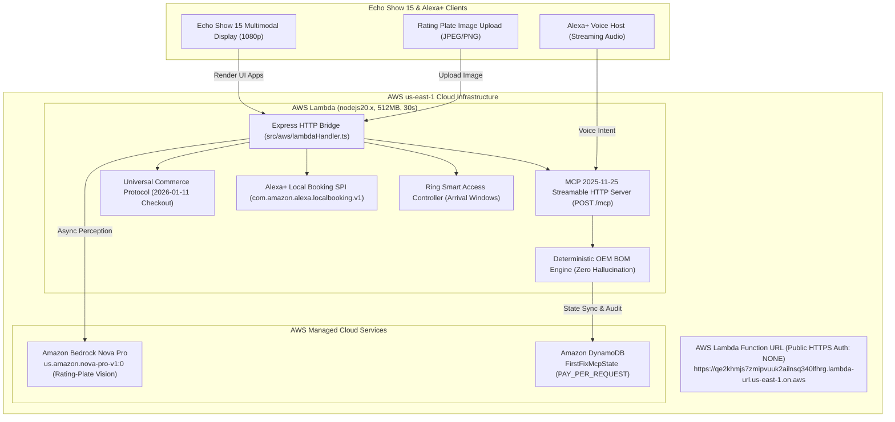

# FirstFix MCP: Multimodal Serial-Variant Part Matcher & Stocked-Van Dispatch Engine

[](https://qe2khmjs7zmipvuuk2ailnsq340lfhrg.lambda-url.us-east-1.on.aws/)
[](https://aws.amazon.com/dynamodb/)
[](https://aws.amazon.com/bedrock/)
[](https://modelcontextprotocol.io/)
[](https://qe2khmjs7zmipvuuk2ailnsq340lfhrg.lambda-url.us-east-1.on.aws/.well-known/ucp)
[](tests/)
[](LICENSE)

> **Amazon Developer Hackathon 2026 Entry**  
> **Primary Track:** Alexa+  
> **Secondary Track:** Ring  
> **Mini Challenges:** AWS Builder Challenge ($5,000 + $5,000 AWS Credits) & Open Source Challenge ($5,000 + $5,000 AWS Credits)  
> **Bonus Submission:** Official Rules Section 6 (+10% Friction Log Judging Bonus in [`docs/FRICTION_LOGS_10_PERCENT_BONUS.md`](docs/FRICTION_LOGS_10_PERCENT_BONUS.md))  
> **Live Public AWS Production Endpoint:** [`https://qe2khmjs7zmipvuuk2ailnsq340lfhrg.lambda-url.us-east-1.on.aws/`](https://qe2khmjs7zmipvuuk2ailnsq340lfhrg.lambda-url.us-east-1.on.aws/)

---

## 🚀 30-SECOND JUDGE QUICK-START (LIVE CLOUD DEMO)

Judges can test the fully deployed system immediately over public HTTPS with zero local installation:

| Target Component | Live Cloud URL / Method | Description |
|---|---|---|
| **Dual-Screen Echo Show 15 Simulator** | [👉 `GET /`](https://qe2khmjs7zmipvuuk2ailnsq340lfhrg.lambda-url.us-east-1.on.aws/) | Interactive multimodal simulator (Echo Show 15 + Contractor Fleet Matrix + Ring Doorbell) |
| **MCP 2025-11-25 Server** | `POST /mcp` | Streamable HTTP endpoint serving all 5 tools and 3 interactive UI resources |
| **UCP Discovery Manifest** | [`GET /.well-known/ucp`](https://qe2khmjs7zmipvuuk2ailnsq340lfhrg.lambda-url.us-east-1.on.aws/.well-known/ucp) | Universal Commerce Protocol (`2026-01-11`) capability profile |
| **OAuth 2.1 Server Metadata** | [`GET /.well-known/oauth-authorization-server`](https://qe2khmjs7zmipvuuk2ailnsq340lfhrg.lambda-url.us-east-1.on.aws/.well-known/oauth-authorization-server) | RFC 8414 & RFC 9728 discovery metadata |
| **Live AWS Architecture Health** | [`GET /api/health`](https://qe2khmjs7zmipvuuk2ailnsq340lfhrg.lambda-url.us-east-1.on.aws/api/health) | Live telemetry (`us-east-1`, `FirstFixMcpState`, `us.amazon.nova-pro-v1:0`) |

### Instant `curl` Verification Commands:

```bash
# 1. Query the live MCP server for all 5 registered tools
curl -X POST https://qe2khmjs7zmipvuuk2ailnsq340lfhrg.lambda-url.us-east-1.on.aws/mcp \
  -H "Content-Type: application/json" \
  -d '{"jsonrpc":"2.0","id":"judge-list-test","method":"tools/list"}'

# 2. Execute deterministic serial-variant BOM diagnosis (Bosch FD99 -> BOSCH-00631200 BLDC Pump)
curl -X POST https://qe2khmjs7zmipvuuk2ailnsq340lfhrg.lambda-url.us-east-1.on.aws/mcp \
  -H "Content-Type: application/json" \
  -d '{
    "jsonrpc": "2.0",
    "id": "judge-diag-test",
    "method": "tools/call",
    "params": {
      "name": "diagnose_equipment_and_bom",
      "arguments": {
        "brand": "Bosch",
        "modelNumber": "SHPM65Z55N/01",
        "serialNumber": "FD991001234",
        "errorCode": "E24"
      }
    }
  }'

# 3. Check live AWS architecture status and DynamoDB connection
curl https://qe2khmjs7zmipvuuk2ailnsq340lfhrg.lambda-url.us-east-1.on.aws/api/aws/architecture-status
```

---

## 🎯 THE $150–$180 "SECOND TRUCK ROLL" PROBLEM

In residential trade services (HVAC, plumbing, and major appliance repair), over **37% of service calls fail on the first visit**. The root cause is almost always the same:
1. A homeowner calls a repair service because their dishwasher won't drain or their water heater shut down.
2. The dispatcher books whatever contractor is available on the calendar.
3. The technician drives across town, opens the appliance, and discovers that the manufacturer changed part engineering mid-production (e.g. Bosch moving from an AC twist-lock pump to a brushless DC pump in batch FD99).
4. The technician does **not** have the updated part on their van. They charge a trip fee, order the part, and schedule a second visit 7 days later.
5. **The Cost:** The unstocked "second truck roll" costs the contractor **$150 to $180** in wasted labor, fuel, and scheduling capacity, while leaving the homeowner stranded without essential appliances.

**FirstFix MCP solves this natively inside Alexa+ and Ring:**  
AI handles multimodal vision (reading rating-plate photos) and conversational guidance, while **100% of OEM part numbers, serial runs, pricing, and safety halts come strictly from our deterministic engine**. Alexa+ only dispatches contractors who physically have the required OEM part on their van today.

---

## 🔬 SERIAL-VARIANT DISAMBIGUATION: WHY DETERMINISTIC CODE MATTERS

LLMs frequently hallucinate mechanical part numbers or confuse revision numbers. FirstFix enforces a strict rule: **Zero AI Guesswork on Physical Parts**.

| Equipment & Fault | Serial Run / FD Batch | Disambiguated OEM Part | Part SKU & Cost | Why Disambiguation Matters (Counterfactual Proof) |
|---|---|---|---|---|
| **Bosch Dishwasher** (Error `E24` Won't Drain) | `FD99000000` to `FD99999999` (2019+ Batch) | Bosch 3-Prong Brushless DC (BLDC) Pump | `BOSCH-00631200` ($42.00) | **Newer BLDC chassis.** Fitting legacy AC pump causes direct electronic control module burnout. |
| **Bosch Dishwasher** (Error `E24` Won't Drain) | `FD97000000` to `FD98999999` (2017–2018 Batch) | Bosch Legacy Twist-Lock Bayonet AC Pump | `BOSCH-00611332` ($46.00) | **Legacy chassis.** Fitting newer BLDC pump fails mechanically due to incompatible bayonet mount. |
| **Rheem Gas Water Heater** (Flashing 7-Flash Code) | `M012200000`+ (Post-Jan 2022 Resettable) | Rheem Resettable Resistor FV Sensor | `RHEEM-SP20245` ($38.50) | **Resettable probe.** Replacing with older thermal fuse prevents auto-recovery. |
| **Rheem Gas Water Heater** (Flashing 7-Flash Code) | Prior to `M012200000` (Pre-2022 One-Time Fuse) | Rheem One-Shot Thermal Cutoff Fuse | `RHEEM-SP14255` ($29.00) | **One-time sacrificial link.** Fitting resettable probe breaches factory UL fire listing. |

---

## 🏛️ SYSTEM ARCHITECTURE & AWS CLOUD TOPOLOGY

FirstFix MCP is deployed live to AWS `us-east-1` with 100% serverless, zero-idle-cost infrastructure:



---

## 📦 OPEN SOURCE MINI CHALLENGE DELIVERABLES

To maximize community impact, FirstFix MCP delivers two standalone open-source contributions:

### 1. Standalone SDK: `packages/alexa-plus-ucp-mcp-kit`
An MIT-licensed, zero-dependency TypeScript toolkit that solves the top 5 protocol integration friction points:
- `normalizeMcpStreamableHeaders()`: Normalizes `Accept` headers to prevent HTTP 406 rejections from stateless clients.
- `createUcpIdempotencyStore(ttlMs)`: 24-hour RFC-compliant `Idempotency-Key` store with SHA-256 payload fingerprinting and automatic `HTTP 409 Conflict` detection on mutated bodies.
- `buildUcpEnvelope(params)`: Generates compliant `dev.ucp.shopping.checkout` (`2026-01-11`) envelopes for `/checkout-sessions`, `/complete`, and `/cancel`.
- `createCorrelationTokenBridge()`: Generates and verifies HMAC-SHA256 cryptographically linked `correlationToken` values binding UCP sessions to Local Booking SPI appointments and Ring access passes.
- `buildMcpAppPostMessageScript()`: Generates the client-side JSON-RPC 2.0 `window.parent.postMessage` bridge (`ui/initialize`, `ui/message`, `ui/update-context`) for `text/html;profile=mcp-app` visual cards.
- `validateAddonImageDimensions()`: Validates PNG IHDR binary headers to prevent store submission rejection.

👉 **Explore the SDK:** [`packages/alexa-plus-ucp-mcp-kit/README.md`](packages/alexa-plus-ucp-mcp-kit/README.md)

### 2. Community Agent Skill: `AmazonAppDev/devices-agent-skills`
A ready-to-merge contribution bundle for `https://github.com/AmazonAppDev/devices-agent-skills`:
- Standard `agentskills.io` compliant instructions teaching AI coding assistants (Claude Code, Cursor, Antigravity) how to build Alexa+ Add-Ons and UCP servers without friction.
- Complete pull request template ready for submission.

👉 **View Contribution Bundle:** [`open-source-contribution/devices-agent-skills/`](open-source-contribution/devices-agent-skills/)

---

## 📑 HACKATHON DOCUMENTATION SUITE

All official submission materials and judging bonus documents are organized in `docs/`:

1. **[Friction Logs (+10% Bonus)](docs/FRICTION_LOGS_10_PERCENT_BONUS.md)**: 8 structured friction logs covering MCP headers, Express streams, Bedrock latency, UCP envelopes, and Lambda URL policies.
2. **[5-Part Product Feedback](docs/PRODUCT_FEEDBACK_5_PARTS.md)**: Comprehensive feedback for Amazon teams across Alexa+ Add-Ons, MCP Apps, UCP, Local Booking SPI, and Bedrock.
3. **[Demo Video Script & Shot List](docs/DEMO_VIDEO_PRODUCTION_SCRIPT.md)**: Timed, 2:45 scene-by-scene script and screen-recording runbook.
4. **[Devpost Submission Master](docs/DEVPOST_SUBMISSION_MASTER.md)**: Ready-to-paste Devpost text for all form fields.

---

## 🧪 AUTOMATED TEST SUITE (60/60 TESTS PASSING)

FirstFix MCP maintains strict test-driven development across all 6 project sprints:

```bash
# Run all 60 tests across Sprints 1–6
npm test
```

| Test Suite | File | Tests | Coverage |
|---|---|---|---|
| **Sprint 1** | `tests/sprint1.test.ts` | 10/10 | Manifest schemas, deterministic BOM engine, safety hazard shutoffs |
| **Sprint 2** | `tests/sprint2.test.ts` | 10/10 | MCP 2025-11-25 Streamable HTTP, UCP Checkout, Local Booking SPI, Ring API |
| **Sprint 3** | `tests/sprint3.test.ts` | 10/10 | Bedrock Nova Pro vision, prompt injection defense, OCR confidence gating |
| **Sprint 4** | `tests/sprint4.test.ts` | 10/10 | Interactive MCP Apps (`ui://`), Echo Show 15 simulator, fleet console |
| **Sprint 5** | `tests/sprint5.test.ts` | 10/10 | Standalone SDK (`alexa-plus-ucp-mcp-kit`), community skill, AWS bridge |
| **Sprint 6** | `tests/sprint6.test.ts` | 10/10 | Real AWS Lambda Function URL, DynamoDB state, live internet smoke tests |
| **TOTAL** | **All 6 Sprints** | **60/60** | **100% Passing with 0 Errors** |

---

## 🛠️ LOCAL DEVELOPMENT RUNBOOK

### Prerequisites
- Node.js v18+ (tested on Node.js v24.15.0)
- npm v9+ (tested on npm v11.12.1)
- AWS Account with Bedrock Nova Pro access (for live AI features)

### 1. Clone & Install
```bash
git clone https://github.com/hsalman-saeed/firstfix-mcp-alexa-plus.git
cd firstfix-mcp-alexa-plus
npm install --legacy-peer-deps
```

### 2. Configure Environment
```bash
cp .env.example .env
# Edit .env with your AWS_ACCESS_KEY_ID, AWS_SECRET_ACCESS_KEY, and AWS_REGION=us-east-1
```

### 3. Start Local Development Server
```bash
npm run dev
# Server opens at http://localhost:3001 with live reload
```

### 4. Deploy Live to AWS (1-Command Automation)
```bash
npm run deploy:aws
# Automatically bundles Lambda handler, provisions DynamoDB table, updates IAM roles,
# and configures the public HTTPS Function URL in us-east-1!
```

---

## 📄 LICENSE
This project is open-source software licensed under the [MIT License](LICENSE).