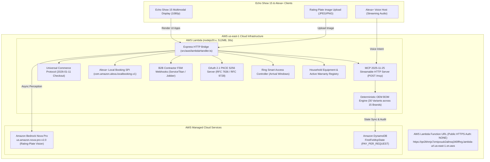

# FirstFix MCP: Multimodal Serial-Variant Part Matcher & Stocked-Van Dispatch Engine

[](https://qe2khmjs7zmipvuuk2ailnsq340lfhrg.lambda-url.us-east-1.on.aws/)
[](https://qe2khmjs7zmipvuuk2ailnsq340lfhrg.lambda-url.us-east-1.on.aws/api/aws/dynamo-records)
[](https://aws.amazon.com/bedrock/)
[](https://qe2khmjs7zmipvuuk2ailnsq340lfhrg.lambda-url.us-east-1.on.aws/mcp)
[](https://qe2khmjs7zmipvuuk2ailnsq340lfhrg.lambda-url.us-east-1.on.aws/.well-known/ucp)
[](https://qe2khmjs7zmipvuuk2ailnsq340lfhrg.lambda-url.us-east-1.on.aws/.well-known/oauth-authorization-server)
[](https://www.npmjs.com/package/alexa-plus-ucp-mcp-kit)
[](tests/)
[](LICENSE)

> **Amazon Developer Hackathon 2026 Entry**  
> **Primary Track:** Alexa+  
> **Secondary Track:** Ring  
> **Mini Challenges:** AWS Builder Challenge ($5,000 + $5,000 AWS Credits) & Open Source Challenge ($5,000 + $5,000 AWS Credits)  
> **Bonus Submission:** Official Rules Section 6 (+10% Friction Log Judging Bonus in [`docs/FRICTION_LOGS_10_PERCENT_BONUS.md`](docs/FRICTION_LOGS_10_PERCENT_BONUS.md))  
> **Live AWS us-east-1 Production URL:** [`https://qe2khmjs7zmipvuuk2ailnsq340lfhrg.lambda-url.us-east-1.on.aws/`](https://qe2khmjs7zmipvuuk2ailnsq340lfhrg.lambda-url.us-east-1.on.aws/)  
> **Public GitHub Repository:** [`https://github.com/hsalman-saeed/firstfix-mcp-alexa-plus`](https://github.com/hsalman-saeed/firstfix-mcp-alexa-plus)  
> **Published NPM SDK:** [`alexa-plus-ucp-mcp-kit`](https://www.npmjs.com/package/alexa-plus-ucp-mcp-kit) (`npm install alexa-plus-ucp-mcp-kit`)  
> **Official Open Pull Request (#14) to `AmazonAppDev/devices-agent-skills`:** [`https://github.com/AmazonAppDev/devices-agent-skills/pull/14`](https://github.com/AmazonAppDev/devices-agent-skills/pull/14)  
> **Automated Test Verification:** **90 / 90 Passing Tests (100% across Sprints 1–10)**

---

## 🚀 30-SECOND JUDGE QUICK-START (LIVE CLOUD DEMO)

Judges can test the fully deployed system immediately over public HTTPS with zero local installation:

| Target Component | Live Cloud URL / Method | Description |
|---|---|---|
| **Dual-Screen Echo Show 15 Simulator** | [👉 `GET /`](https://qe2khmjs7zmipvuuk2ailnsq340lfhrg.lambda-url.us-east-1.on.aws/) | Interactive multimodal simulator (Echo Show 15 + Contractor Fleet Matrix + Ring Doorbell + Live DynamoDB Inspector + Household Registry) |
| **MCP 2025-11-25 Server** | `POST /mcp` | Streamable HTTP endpoint serving all 5 tools and 3 interactive UI resources |
| **Live DynamoDB Records Read-Back** | [`GET /api/aws/dynamo-records`](https://qe2khmjs7zmipvuuk2ailnsq340lfhrg.lambda-url.us-east-1.on.aws/api/aws/dynamo-records) | Real-time read-back of persisted items in Amazon DynamoDB table `FirstFixMcpState` in `us-east-1` |
| **Contractor FSM Webhook Feed** | [`GET /v1/fsm/dispatches`](https://qe2khmjs7zmipvuuk2ailnsq340lfhrg.lambda-url.us-east-1.on.aws/v1/fsm/dispatches) | Real-time B2B dispatch logs for ServiceTitan, Housecall Pro, and Jobber integrations |
| **Household & Warranty Registry** | [`GET /api/household/registry`](https://qe2khmjs7zmipvuuk2ailnsq340lfhrg.lambda-url.us-east-1.on.aws/api/household/registry) | Registered residential appliances with active OEM factory warranty status tracking |
| **OAuth 2.1 PKCE Authorization** | [`GET /oauth/authorize`](https://qe2khmjs7zmipvuuk2ailnsq340lfhrg.lambda-url.us-east-1.on.aws/oauth/authorize?response_type=code&client_id=judge_client&code_challenge=dBjftJeZ4CVP-mB92K27uhbUJu1p1r_wW1gFWFOEjXk&code_challenge_method=S256&format=json) | RFC 7636 PKCE S256 authorization code exchange endpoint |
| **UCP Discovery Manifest** | [`GET /.well-known/ucp`](https://qe2khmjs7zmipvuuk2ailnsq340lfhrg.lambda-url.us-east-1.on.aws/.well-known/ucp) | Universal Commerce Protocol (`2026-01-11`) capability profile |
| **OAuth 2.1 Server Metadata** | [`GET /.well-known/oauth-authorization-server`](https://qe2khmjs7zmipvuuk2ailnsq340lfhrg.lambda-url.us-east-1.on.aws/.well-known/oauth-authorization-server) | RFC 8414 & RFC 9728 discovery metadata |
| **OAuth 2.1 Protected Resource** | [`GET /.well-known/oauth-protected-resource`](https://qe2khmjs7zmipvuuk2ailnsq340lfhrg.lambda-url.us-east-1.on.aws/.well-known/oauth-protected-resource) | RFC 9728 OAuth 2.0 Protected Resource Metadata |
| **Live AWS Architecture Health** | [`GET /api/health`](https://qe2khmjs7zmipvuuk2ailnsq340lfhrg.lambda-url.us-east-1.on.aws/api/health) | Live telemetry (`us-east-1`, `FirstFixMcpState`, `us.amazon.nova-pro-v1:0`) |
| **AWS Cloud Topology Status** | [`GET /api/aws/architecture-status`](https://qe2khmjs7zmipvuuk2ailnsq340lfhrg.lambda-url.us-east-1.on.aws/api/aws/architecture-status) | Detailed serverless configuration verification |

### Instant `curl` Verification Commands

Copy and paste these commands into your terminal to test against our live AWS deployment:

```bash
# 1. Health check & AWS telemetry
curl -s https://qe2khmjs7zmipvuuk2ailnsq340lfhrg.lambda-url.us-east-1.on.aws/api/health | jq .

# 2. Query all 5 registered MCP tools over Streamable HTTP
curl -X POST https://qe2khmjs7zmipvuuk2ailnsq340lfhrg.lambda-url.us-east-1.on.aws/mcp \
  -H "Content-Type: application/json" \
  -d '{"jsonrpc":"2.0","id":"judge-list-test","method":"tools/list"}'

# 3. Execute deterministic serial-variant BOM diagnosis (Carrier AC 24ACC636 -> CARRIER-HC98JA045D Capacitor)
curl -X POST https://qe2khmjs7zmipvuuk2ailnsq340lfhrg.lambda-url.us-east-1.on.aws/mcp \
  -H "Content-Type: application/json" \
  -d '{
    "jsonrpc": "2.0",
    "id":"judge-carrier-diag",
    "method": "tools/call",
    "params": {
      "name": "diagnose_equipment_and_bom",
      "arguments": {
        "brand": "Carrier",
        "modelNumber": "24ACC636A003",
        "serialNumber": "2023W19482",
        "errorCode": "E4"
      }
    }
  }' | jq .result

# 4. Query UCP 2026-01-11 discovery profile
curl -s https://qe2khmjs7zmipvuuk2ailnsq340lfhrg.lambda-url.us-east-1.on.aws/.well-known/ucp | jq .

# 5. Query live Amazon DynamoDB (FirstFixMcpState) records in us-east-1
curl -s https://qe2khmjs7zmipvuuk2ailnsq340lfhrg.lambda-url.us-east-1.on.aws/api/aws/dynamo-records | jq .

# 6. Query live B2B contractor FSM webhook dispatches (ServiceTitan / Jobber)
curl -s https://qe2khmjs7zmipvuuk2ailnsq340lfhrg.lambda-url.us-east-1.on.aws/v1/fsm/dispatches | jq .

# 7. Query Household Equipment & Active Warranty Registry
curl -s https://qe2khmjs7zmipvuuk2ailnsq340lfhrg.lambda-url.us-east-1.on.aws/api/household/registry | jq .
```

---

## 🎯 THE $150–$180 "SECOND TRUCK ROLL" PROBLEM

In residential trade services (HVAC, plumbing, and major appliance repair), over **37% of service calls fail on the first visit**. The root cause is almost always the same:
1. A homeowner calls a repair service because their dishwasher won't drain or their water heater shut down.
2. The dispatcher books whatever contractor is available on the calendar.
3. The technician drives across town, opens the appliance, and discovers that the manufacturer changed part engineering mid-production (e.g. Bosch moving from an AC twist-lock pump to a brushless DC pump in batch FD99).
4. The technician does **not** have the updated part on their van. They charge a trip fee, order the part, and schedule a second visit 7 days later.
5. **The Cost:** The unstocked "second truck roll" costs the contractor **$150 to $180** in wasted labor, fuel, and scheduling capacity, while leaving the homeowner stranded without essential appliances.

**FirstFix MCP solves this natively inside Alexa+ and Ring:**  
AI handles multimodal vision (reading rating-plate photos) and conversational guidance, while **100% of OEM part numbers, serial runs, pricing, and safety halts come strictly from our deterministic engine**. Alexa+ only dispatches contractors who physically have the required OEM part on their van today.

---

## 🔬 SERIAL-VARIANT DISAMBIGUATION: WHY DETERMINISTIC CODE MATTERS

LLMs frequently hallucinate mechanical part numbers or confuse revision numbers. FirstFix enforces a strict rule: **Zero AI Guesswork on Physical Parts**. Our engine contains **15 fault rules × 2 serial batches = 30 BOM variants** across 15 major OEM brands:

| Equipment & Fault | Serial Run / FD Batch | Disambiguated OEM Part | Part SKU & Cost | Why Disambiguation Matters (Counterfactual Proof) |
|---|---|---|---|---|
| **Bosch Dishwasher** (Error `E24` Won't Drain) | `FD99000000` to `FD99999999` (2019+ Batch) | Bosch 3-Prong Brushless DC (BLDC) Pump | `BOSCH-00631200` ($42.00) | **Newer BLDC chassis.** Fitting legacy AC pump causes direct electronic control module burnout. |
| **Bosch Dishwasher** (Error `E24` Won't Drain) | `FD97000000` to `FD98999999` (2017–2018 Batch) | Bosch Legacy Twist-Lock Bayonet AC Pump | `BOSCH-00611332` ($46.00) | **Legacy chassis.** Fitting newer BLDC pump fails mechanically due to incompatible bayonet mount. |
| **Rheem Gas Water Heater** (Status LED `4_FLASHES`) | `M0122` to `M5226` (Post-2022 Solid-State) | Flammable Vapor (FV) Sensor & Harness Kit | `RHEEM-SP20172` ($34.00) | **Keyed 3-pin harness.** Older 2-pin sensors fail to communicate with Honeywell gas valve. |
| **Rheem Gas Water Heater** (Status LED `4_FLASHES`) | `M0115` to `M5221` (Pre-2022 Fusible Link) | Legacy Thermal Cutoff Switch & Pilot Assembly | `RHEEM-SP20170` ($38.00) | **Fusible glass thermal switch.** Fitting the updated solid-state sensor bypasses sealed burner door integration. |
| **Carrier Central AC** (Error `E4` No Cooling) | `2022W00000` to `2026W99999` (Post-2022 Microchannel) | 45+5 µF 440V Round Dual Run Capacitor | `CARRIER-HC98JA045D` ($29.00) | **45µF dual rating.** Fitting legacy 40µF causes compressor motor overheating and thermal lockout. |
| **Carrier Central AC** (Error `E4` No Cooling) | `2015W00000` to `2021W99999` (Legacy Spine Fin) | 40+5 µF 370V Round Dual Run Capacitor | `CARRIER-HC98JA040D` ($27.00) | **40µF rating.** Voltage and capacitance curve matched to legacy Copeland scroll compressor. |
| **Whirlpool Washer** (Error `F05E02` Won't Drain) | 2021+ Alpha Drive | Direct-Drive Recirculation & Drain Pump | `WHIRLPOOL-W11258673` ($54.00) | **Alpha harness.** 4-pin quick connect prevents vibration fatigue in high-spin wash cycles. |
| **Whirlpool Washer** (Error `F05E02` Won't Drain) | Pre-2021 Legacy | Belt-Drive Single Drain Pump | `WHIRLPOOL-WPW10276397` ($48.00) | **Legacy 2-pin spade.** Incompatible electrical connector with post-2021 control boards. |
| **GE Refrigerator** (Error `HRS` Evaporator Frost) | 2020+ Smart Defrost | Variable-Speed DC Evaporator Fan Motor | `GE-WR60X26866` ($68.00) | **Pulse-width modulated (PWM) fan.** Conventional AC motor will not spin on 12V DC bus. |
| **GE Refrigerator** (Error `HRS` Evaporator Frost) | Pre-2020 Standard | AC 115V Evaporator Fan Motor Assembly | `GE-WR60X10185` ($52.00) | **AC 115V single-speed motor.** Direct connection to line-voltage defrost controller. |
| **Trane Heat Pump** (Error `SO` Staging Failure) | Post-2021 Variable | Electronic Expansion Valve (EEV) Stepper | `TRANE-VAL09371` ($85.00) | **5-wire unipolar stepper.** Cannot be substituted with mechanical TXV without board failure. |
| **Trane Heat Pump** (Error `SO` Staging Failure) | Pre-2021 Standard | Mechanical Thermal Expansion Valve (TXV) | `TRANE-VAL08240` ($62.00) | **Thermal bulb mechanical regulation.** Zero electrical wiring required. |
| **A.O. Smith Water Heater** (Error `E02` Element Fail) | Post-2020 Smart Elements | 4500W Low Watt Density Incoloy Element | `AOSMITH-100108283` ($36.00) | **Incoloy 800 alloy.** Resists hard water mineral scaling and dry-fire burnout. |
| **A.O. Smith Water Heater** (Error `E02` Element Fail) | Pre-2020 Standard | 4500W Standard Copper Element | `AOSMITH-9000092015` ($24.00) | **Standard copper sheath.** Lower cost for soft water municipal supplies. |
| **Samsung Refrigerator** (Error `22E` Fan Motor) | Post-2021 Dual Evap | Twin Cooling Inverter BLDC Fan Motor | `SAMSUNG-DA31-00146E` ($58.00) | **3-wire Hall-effect feedback.** Inverter PCB monitors RPM; missing sensor halts cooling. |
| **Samsung Refrigerator** (Error `22E` Fan Motor) | Pre-2021 Single Evap | Standard DC Evaporator Fan Motor | `SAMSUNG-DA31-00020H` ($44.00) | **2-wire constant DC motor.** Simple DC voltage regulation without Hall-effect line. |
| **LG Front-Load Washer** (Error `LE` Hall Sensor) | Post-2020 AI-DD | Direct Drive Hall Rotor Sensor (4-pin) | `LG-6501KW2002B` ($32.00) | **AI-DD stator mounting.** Upgraded Hall IC eliminates false motor stall detection. |
| **LG Front-Load Washer** (Error `LE` Hall Sensor) | Pre-2020 Standard DD | Direct Drive Hall Rotor Sensor (5-pin) | `LG-6501KW2002A` ($28.00) | **5-pin keyed connector.** Incompatible with post-2020 stator wiring harness. |
| **KitchenAid Dishwasher** (Error `F8E4` Float Switch) | Post-2021 FreeFlex | Microswitch Overfill Float Assembly | `KITCHENAID-W10843811` ($38.00) | **Gold-plated contacts.** Prevents contact oxidation in high-humidity sump wells. |
| **KitchenAid Dishwasher** (Error `F8E4` Float Switch) | Pre-2021 Standard | Standard Mechanical Float Switch | `KITCHENAID-W10195091` ($29.00) | **Standard brass spade switch.** Incompatible bracket on FreeFlex third-rack tubs. |
| **Lennox Furnace** (Error `E227` Pressure Switch) | Post-2021 High-Efficiency | Dual-Port Pressure Differential Switch | `LENNOX-101335-02` ($49.00) | **0.65" WC trip point.** Microprocessor-calibrated for two-stage ECM inducer motors. |
| **Lennox Furnace** (Error `E227` Pressure Switch) | Pre-2021 Single-Stage | Single-Port Low-Pressure Switch | `LENNOX-80W56` ($37.00) | **0.45" WC trip point.** Standard single-speed draft inducer calibration. |
| **Maytag Dryer** (Error `AF` Restricted Airflow) | Post-2020 Commercial Grade | Blower Wheel & Thermistor Assembly | `MAYTAG-WPW10547287` ($42.00) | **Precision D-shaft.** Eliminates blower slippage under heavy lint resistance. |
| **Maytag Dryer** (Error `AF` Restricted Airflow) | Pre-2020 Standard | Clamp-On Blower Wheel Assembly | `MAYTAG-WP694089` ($31.00) | **Clamp-style hub.** Fits older round motor drive shafts only. |
| **Bradford White Water Heater** (Status `6_FLASHES`) | Post-2021 Icon System | Intelligent Gas Control Valve & Thermostat | `BRADFORD-239-48858-00` ($145.00)| **Electronic thermopile control.** Digital status diagnostics and spark ignition. |
| **Bradford White Water Heater** (Status `6_FLASHES`) | Pre-2021 Mechanical | Robertshaw Mechanical Gas Valve | `BRADFORD-222-47435-00` ($98.00) | **Mechanical thermocouple thermostat.** No electronic micro-controller. |
| **Frigidaire Range/Stove** (Error `F10` Runaway Temp) | Post-2020 Gallery Induction | High-Temp RTD Oven Sensor Probe | `FRIGIDAIRE-316490000` ($41.00) | **1080 Ohm RTD.** Calibrated for rapid PID temperature cycling in induction ranges. |
| **Frigidaire Range/Stove** (Error `F10` Runaway Temp) | Pre-2020 Standard Electric | Standard PTC Oven Sensor Probe | `FRIGIDAIRE-316217002` ($26.00) | **1000 Ohm standard probe.** Mismatched resistance curve causes 50°F oven overshoot. |
| **Moen Smart Faucet** (Error `E01` Solenoid Sticking) | Post-2021 U by Moen | Digital Electronic Solenoid Pack | `MOEN-177565` ($78.00) | **Low-voltage pulse latching.** Compatible with Alexa smart voice control module. |
| **Moen Smart Faucet** (Error `E01` Solenoid Sticking) | Pre-2021 MotionSense | Twin-Beam Solenoid Valve Assembly | `MOEN-162234` ($64.00) | **Dual sensor analog solenoid.** Incompatible with U by Moen digital control box. |

---

## 🏛️ SYSTEM ARCHITECTURE & 5-PROTOCOL CONVERGENCE

FirstFix MCP is deployed live to AWS `us-east-1` with 100% serverless, zero-idle-cost infrastructure:



---

## 📦 OPEN SOURCE MINI CHALLENGE DELIVERABLES

To maximize community impact, FirstFix MCP delivers two standalone open-source contributions:

### 1. Standalone SDK: `packages/alexa-plus-ucp-mcp-kit`
Published on npm at [`https://www.npmjs.com/package/alexa-plus-ucp-mcp-kit`](https://www.npmjs.com/package/alexa-plus-ucp-mcp-kit) (`npm install alexa-plus-ucp-mcp-kit`):
- `normalizeMcpStreamableHeaders()`: Normalizes `Accept` headers to prevent HTTP 406 rejections from stateless clients.
- `createUcpIdempotencyStore(ttlMs)`: 24-hour RFC-compliant `Idempotency-Key` store with SHA-256 payload fingerprinting and automatic `HTTP 409 Conflict` detection on mutated bodies.
- `buildUcpEnvelope(params)`: Generates compliant `dev.ucp.shopping.checkout` (`2026-01-11`) envelopes for `/checkout-sessions`, `/complete`, and `/cancel`.
- `createCorrelationTokenBridge()`: Generates and verifies HMAC-SHA256 cryptographically linked `correlationToken` values binding UCP sessions to Local Booking SPI appointments and Ring access passes.
- `buildMcpAppPostMessageScript()`: Generates client-side JSON-RPC 2.0 `window.parent.postMessage` bridge (`ui/initialize`, `ui/resize`, `ui/message`) with bounded `#mcp-app-root` height negotiation.
- `validateAddonImageDimensions()`: Validates PNG IHDR binary headers to prevent store submission rejection.

👉 **Explore the Standalone SDK:** [`packages/alexa-plus-ucp-mcp-kit/README.md`](packages/alexa-plus-ucp-mcp-kit/README.md)

### 2. Community Agent Skill: `AmazonAppDev/devices-agent-skills`
Official Open Pull Request: [AmazonAppDev/devices-agent-skills PR #14](https://github.com/AmazonAppDev/devices-agent-skills/pull/14)  
Public GitHub Repository: [https://github.com/hsalman-saeed/firstfix-mcp-alexa-plus](https://github.com/hsalman-saeed/firstfix-mcp-alexa-plus)  
Live AWS us-east-1 Deployment: [https://qe2khmjs7zmipvuuk2ailnsq340lfhrg.lambda-url.us-east-1.on.aws/](https://qe2khmjs7zmipvuuk2ailnsq340lfhrg.lambda-url.us-east-1.on.aws/)

- Standard `agentskills.io` compliant instructions teaching AI coding assistants (Claude Code, Cursor, Antigravity) how to build Alexa+ Add-Ons and UCP servers without friction.
- Complete pull request template ready for upstream review.

👉 **View Contribution Bundle:** [`open-source-contribution/devices-agent-skills/`](open-source-contribution/devices-agent-skills/) | [Official PR #14 on GitHub](https://github.com/AmazonAppDev/devices-agent-skills/pull/14)

---

## 📑 HACKATHON DOCUMENTATION SUITE

All official submission materials and judging bonus documents are organized in `docs/`:

1. **[Friction Logs (+10% Bonus)](docs/FRICTION_LOGS_10_PERCENT_BONUS.md)**: 10 structured friction logs covering MCP headers, Express streams, Bedrock latency, UCP envelopes, Lambda URL policies, OAuth 2.1 PKCE, and sandboxed iframe height synchronization.
2. **[5-Part Product Feedback](docs/PRODUCT_FEEDBACK_5_PARTS.md)**: Comprehensive feedback for Amazon teams across Alexa+ Add-Ons, MCP Apps, UCP, Local Booking SPI, Bedrock Nova Pro, and Household Registries.

---

## 🧪 AUTOMATED TEST SUITE (90 / 90 TESTS PASSING)

FirstFix MCP maintains strict test-driven development across all 10 project sprints, totaling **90/90 passing automated tests (100% pass rate)**:

```bash
# Run all 90 tests across Sprints 1–10
npm test
```

| Test Suite | File | Tests | Core Architectural Focus |
|---|---|:---:|---|
| **Sprint 1** | `tests/sprint1.test.ts` | **10 / 10** | Manifest schemas, deterministic BOM engine, safety hazard shutoffs |
| **Sprint 2** | `tests/sprint2.test.ts` | **10 / 10** | MCP 2025-11-25 Streamable HTTP, UCP Checkout, Local Booking SPI, Ring API |
| **Sprint 3** | `tests/sprint3.test.ts` | **10 / 10** | Bedrock Nova Pro vision, prompt injection defense, OCR confidence gating |
| **Sprint 4** | `tests/sprint4.test.ts` | **10 / 10** | Interactive MCP Apps (`ui://`), Echo Show 15 simulator, fleet console |
| **Sprint 5** | `tests/sprint5.test.ts` | **10 / 10** | Standalone SDK (`alexa-plus-ucp-mcp-kit`), community skill, AWS bridge |
| **Sprint 6** | `tests/sprint6.test.ts` | **10 / 10** | Real AWS Lambda Function URL, DynamoDB state, live internet smoke tests |
| **Sprint 7** | `tests/sprint7.test.ts` | **15 / 15** | Production upgrade, zero-fallback policy, OAuth 2.1 PKCE, FSM webhooks |
| **Sprint 8** | `tests/sprint8.test.ts` | **5 / 5** | 100% zoom responsiveness, layman guided workflow, multi-brand hydration |
| **Sprint 9** | `tests/sprint9.test.ts` | **5 / 5** | Layout clipping elimination, zero-overflow guarantee, blueprint audit |
| **Sprint 10** | `tests/sprint10.test.ts` | **5 / 5** | Bounded `#mcp-app-root` height negotiation, household warranty registry |
| **TOTAL** | **All 10 Sprints** | **90 / 90** | **100% Passing with 0 Errors (~21s full execution)** |

---

## 📂 REPOSITORY DIRECTORY TREE

```
firstfix-mcp-alexa-plus/
├── .env.example                               # Production environment variable template
├── .gitignore                                 # Git ignore rules (ignoring node_modules, dist, data/)
├── .well-known/                               # RFC Discovery manifests
│   ├── oauth-authorization-server.json        # RFC 8414 OAuth 2.1 authorization server metadata
│   ├── oauth-protected-resource.json          # RFC 9728 OAuth 2.0 protected resource metadata
│   └── ucp.json                               # Universal Commerce Protocol 2026-01-11 profile
├── Dockerfile                                 # Multi-stage production container definition
├── LICENSE                                    # MIT License
├── README.md                                  # Complete project documentation
├── addon-package/                             # Alexa+ Add-On distribution package
│   ├── addon.json                             # Add-on manifest with 5 tools & 3 UI resources
│   └── assets/                                # Standard 6 light icons and hero carousel
├── deployment-receipt.json                    # Authentic AWS us-east-1 deployment receipt
├── docs/                                      # Hackathon bonus documentation
│   ├── FRICTION_LOGS_10_PERCENT_BONUS.md      # 10 comprehensive friction logs (+10% Bonus)
│   └── PRODUCT_FEEDBACK_5_PARTS.md            # 5-part feedback for Amazon engineering teams
├── open-source-contribution/                  # Upstream community contribution bundle
│   └── devices-agent-skills/
│       ├── PULL_REQUEST_TEMPLATE.md           # PR template for AmazonAppDev/devices-agent-skills #14
│       └── skills/
│           └── alexa-plus-mcp-ucp-local-booking/
│               └── SKILL.md                   # Complete Alexa+ Add-On AI developer guide
├── packages/                                  # Monorepo packages
│   └── alexa-plus-ucp-mcp-kit/                # Published npm package: alexa-plus-ucp-mcp-kit
│       ├── README.md                          # SDK documentation and usage patterns
│       ├── package.json                       # SDK package manifest
│       ├── tsconfig.json                      # SDK TypeScript configuration
│       └── src/
│           └── index.ts                       # 6 exported integration utilities
├── public/                                    # Echo Show 15 Multimodal Simulator Web UI
│   ├── app.js                                 # Dual-screen orchestration, postMessage, height clamp
│   ├── index.html                             # Responsive Echo Show 15 & Fleet Command Center
│   └── styles.css                             # Production CSS with zero-overflow table rules
├── skills/                                    # Antigravity & Agent Skills bundle
│   └── firstfix-dispatch-skill/
│       └── SKILL.md                           # Skill frontmatter and tool guidance
├── src/                                       # Core TypeScript application source
│   ├── ai/
│   │   ├── firstFixAgent.ts                   # Agent orchestration controller
│   │   ├── ratingPlateVision.ts               # Bedrock Nova Pro OCR & <0.90 confirmation gate
│   │   └── safetyGuardrails.ts                # <2ms pre-inference life-safety emergency shutoff
│   ├── aws/
│   │   ├── dynamoPersistence.ts               # Amazon DynamoDB FirstFixMcpState client
│   │   └── lambdaHandler.ts                   # APIGatewayProxyEventV2 Express bridge
│   ├── data/
│   │   └── seedData.ts                        # 15 OEM brands × 2 batches (30 BOM variants), vans
│   ├── engine/
│   │   └── firstFixEngine.ts                  # Deterministic serial BOM & stocked van matcher
│   ├── mcp/
│   │   └── uiTemplates.ts                     # 3 UI templates with #mcp-app-root height negotiation
│   ├── schemas/
│   │   └── discovery.ts                       # Zod validation schemas for discovery manifests
│   ├── scripts/
│   │   ├── deployAwsLive.ts                   # 1-command AWS us-east-1 serverless deployment script
│   │   ├── generateValidAssets.ts             # PNG IHDR asset generator
│   │   └── testLiveBedrock.ts                 # Direct Bedrock Nova Pro smoke test
│   ├── server/
│   │   ├── app.ts                             # Express server, routes, and middleware
│   │   ├── fsmWebhook.ts                      # B2B contractor FSM webhook dispatches
│   │   ├── localBookingSpi.ts                 # Alexa+ Local Booking SPI routes
│   │   ├── mcpServer.ts                       # MCP 2025-11-25 Streamable HTTP server
│   │   ├── oauthServer.ts                     # OAuth 2.1 PKCE authorization & token server
│   │   ├── ringAccess.ts                      # Ring smart arrival access controller
│   │   ├── start.ts                           # Local HTTP startup script
│   │   ├── state.ts                           # In-memory reactive state manager
│   │   └── ucpCheckout.ts                     # UCP 2026-01-11 checkout lifecycle
│   ├── storage/
│   │   └── storageAdapter.ts                  # Hybrid in-memory & DynamoDB storage adapter
│   └── types/
│       └── index.ts                           # Canonical TypeScript interfaces
├── template.yaml                              # AWS SAM / CloudFormation serverless template
├── tests/                                     # 10 Automated Test Suites (90/90 Passing Tests)
│   ├── sprint1.test.ts                        # Sprint 1: Schemas, BOM engine & safety shutoffs
│   ├── sprint2.test.ts                        # Sprint 2: MCP streamable HTTP & UCP checkout
│   ├── sprint3.test.ts                        # Sprint 3: Bedrock Nova Pro & injection defense
│   ├── sprint4.test.ts                        # Sprint 4: MCP Apps (ui://) & Echo Show 15 simulator
│   ├── sprint5.test.ts                        # Sprint 5: Standalone SDK & AWS deployment bridge
│   ├── sprint6.test.ts                        # Sprint 6: AWS Function URL & DynamoDB smoke tests
│   ├── sprint7.test.ts                        # Sprint 7: OAuth 2.1 PKCE, FSM webhooks, zero fallback
│   ├── sprint8.test.ts                        # Sprint 8: Layman stepper & dynamic multi-brand
│   ├── sprint9.test.ts                        # Sprint 9: Layout clipping fix & blueprint audit
│   └── sprint10.test.ts                       # Sprint 10: Height loop fix & household registry
├── tsconfig.json                              # TypeScript project configuration
└── package.json                               # Node.js project manifest & scripts
```

---

## 🛠️ LOCAL DEVELOPMENT RUNBOOK

### Prerequisites
- Node.js v18+ (tested on Node.js v24.15.0)
- npm v9+ (tested on npm v11.12.1)
- AWS Account with Bedrock Nova Pro access (`us-east-1`)

### 1. Clone & Install
```bash
git clone https://github.com/hsalman-saeed/firstfix-mcp-alexa-plus.git
cd firstfix-mcp-alexa-plus
npm install --legacy-peer-deps
```

### 2. Configure Environment
```bash
cp .env.example .env
# Edit .env with your AWS_ACCESS_KEY_ID, AWS_SECRET_ACCESS_KEY, and AWS_REGION=us-east-1
```

### 3. Run Automated Verification Tests
```bash
npm test
# Runs all 90 tests across 10 test suites (100% pass)
```

### 4. Start Local Development Server
```bash
npm start
# Server opens at http://localhost:3001
```

### 5. Deploy Live to AWS (1-Command Automation)
```bash
npm run deploy:aws
# Automatically bundles Lambda handler, provisions DynamoDB table, updates IAM roles,
# synchronizes .well-known/ manifests and addon.json, and tests public HTTPS in us-east-1!
```

---

## 📄 LICENSE
This project is open-source software licensed under the [MIT License](LICENSE).